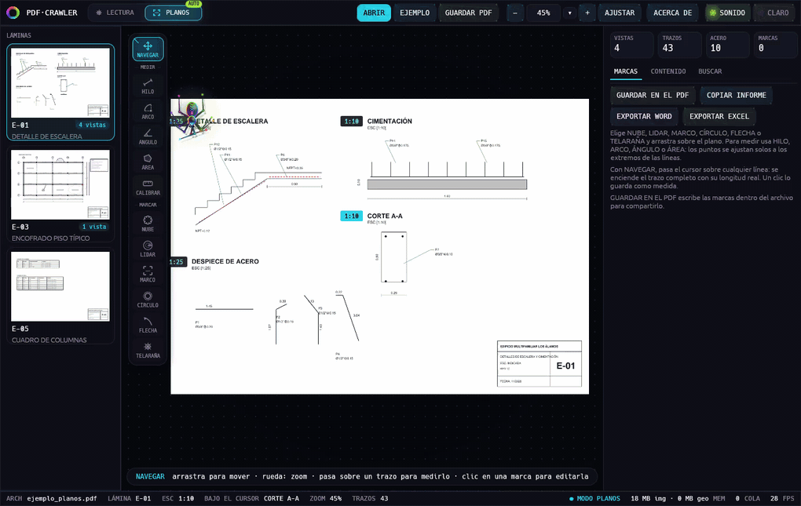
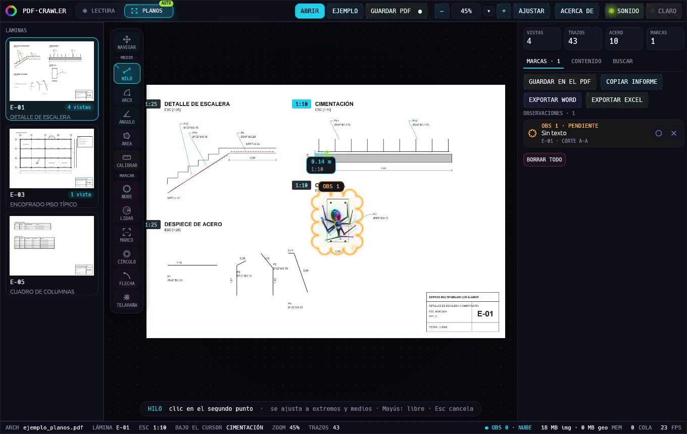
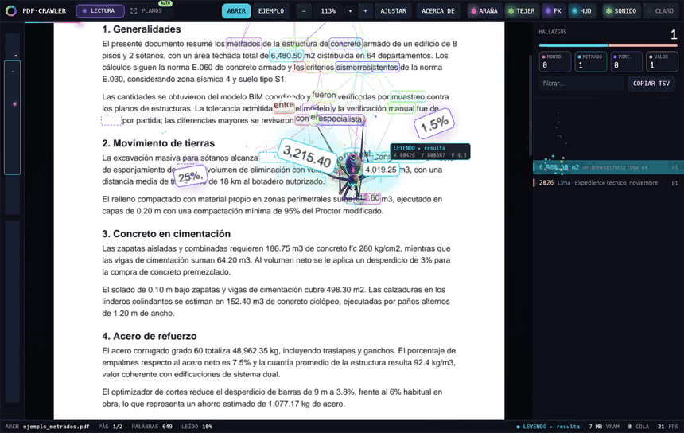

# PDF Crawler

**Visor PDF para ingeniería, con una araña que lee contigo y un modo planos que mide sobre la geometría real.**

  
  
  

  

 

## Qué es

PDF Crawler abre memorias, especificaciones y láminas, y detecta solo qué está mirando:

- **LECTURA** para documentos de texto: una araña camina sobre las palabras y arranca las cifras del papel (montos, metrados, porcentajes) a una lista que puedes filtrar y copiar.
- **PLANOS** para láminas: pasas el cursor por cualquier línea y se enciende con su longitud real según la escala de la vista.

Es un solo `.exe`. No se instala, no pide permisos de administrador, no necesita internet ni Office.

 

## Modo planos

<table>
<tr>
<td width="50%" valign="top">

### 📐 Medir sobre la geometría real
- **Trazos vivos:** el cursor enciende la línea completa con su longitud; un clic la guarda.
- **HILO, ARCO, ÁNGULO y ÁREA**, con ajuste a extremos y puntos medios.
- **Escala automática:** lee `ESC 1:50` del rótulo de cada vista. También puedes **CALIBRAR** con una cota conocida.
- Contenido de la lámina: vistas, acero por diámetro, niveles y cotas.

</td>
<td width="50%" valign="top">

### ☁️ Observar con estilo
- **NUBE, LIDAR, MARCO, CÍRCULO, FLECHA y TELARAÑA**, todas animadas.
- Cada observación lleva texto, **prioridad** y **estado**.
- Se mueven, se editan y se borran; **Ctrl+Z** deshace.
- Búsqueda en todas las láminas: la araña te lleva a cada resultado.

</td>
</tr>
<tr>
<td width="50%" valign="top">

### 💾 Guardado dentro del PDF
**GUARDAR PDF** crea una copia `_revisado.pdf` con las marcas como anotaciones, visibles en cualquier visor y en la lista de comentarios de Acrobat. Al reabrirlo aquí, las marcas vuelven a ser editables.

</td>
<td width="50%" valign="top">

### 📊 Informes en Word y Excel
- **Word:** resumen en cifras, una ficha por observación con el recorte de la lámina y una tabla de medidas.
- **Excel:** hojas de observaciones y medidas con filtros y colores por prioridad.

</td>
</tr>
</table>

 

## Modo lectura

 

La araña recorre el texto real del PDF y extrae cada cifra con su unidad y su contexto. Cuando te detienes, teje una telaraña sobre la más importante. Todos los sonidos se sintetizan en tiempo real y se pueden silenciar.

 

## Hecho para planos pesados

| | |
|---|---|
| **Lámina A1 de ~386 000 segmentos** | geometría lista en ~2 s |
| **Memoria** | solo se dibuja lo visible, en mosaicos, con un límite de memoria fijo |
| **Fluidez** | la lectura del PDF y el índice de la geometría corren en hilos aparte; la interfaz no se traba |
| **PDFs protegidos** | se abren con su contraseña y el guardado queda bloqueado |

 

## Descargar y usar

1. Descarga **`PDFCrawler.exe`** desde [Releases](../../releases/latest).
2. Ábrelo. No requiere instalación.
3. Arrastra un PDF a la ventana o usa **ABRIR**. **EJEMPLO** carga una lámina de muestra para probar.

> Requiere Windows 10 u 11 de 64 bits. Si Windows SmartScreen muestra un aviso, elige *Más información → Ejecutar de todas formas*. Aparece porque el ejecutable no está firmado con un certificado comercial.

 

## Atajos del modo planos

| Herramienta | Tecla | | Acción | Tecla |
|---|:---:|---|---|:---:|
| Navegar | `V` | | Cancelar | `Esc` |
| Hilo · Arco · Ángulo | `L` `R` `G` | | Borrar marca | `Supr` |
| Área · Calibrar | `A` `K` | | Deshacer | `Ctrl` `Z` |
| Nube · Lidar · Marco | `N` `D` `H` | | Cerrar área | doble clic |
| Círculo · Flecha · Telaraña | `C` `F` `W` | | Punto libre | `Mayús` |

 

## Créditos

Hecho por **Jhon Mires** · **Code Toys**
